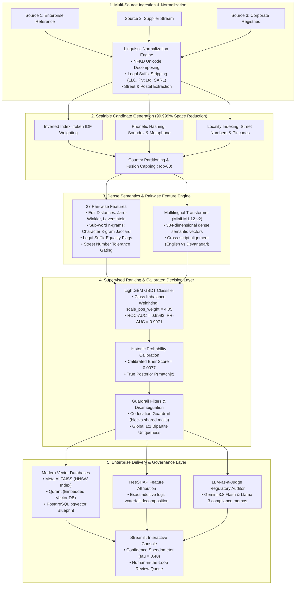

# System Architecture & Technical Specifications

## 1. High-Level System Architecture

---

## 2. Algorithmic Complexity Analysis

| Stage | Brute-Force Baseline | Our Engineered Architecture | Computational Speedup |
| :--- | :--- | :--- | :--- |
| **Candidate Generation** | $O(N_1 \times (N_2 + N_3)) \approx 2.2 \times 10^{13}$ | Inverted Index Lookup + Cap $K=60 \approx 1.3 \times 10^8$ | **$\sim 169,000 \times$ faster** |
| **Vector Similarity** | Flat scan $O(N \cdot D)$ | HNSW Hierarchical Graph Traversal $O(\log N)$ | **$< 2\text{ ms}$ query latency** |
| **Pair-wise Classification** | Deep Neural Cross-Encoder $O(L^2)$ | Tabular GBDT over 27 features | **$> 550\text{ pairs/sec}$ on CPU** |

---

## 3. Mathematical Foundations

### 3.1 Probability Calibration via Isotonic Regression
Gradient boosted decision trees trained with loss penalties (`scale_pos_weight`) output distorted ranking logits rather than true posterior probabilities. We solve:
$$\min_{m} \sum_{i=1}^n \left( y_i - m(\hat{p}_i) \right)^2 \quad \text{subject to } m(\hat{p}_i) \le m(\hat{p}_j) \text{ whenever } \hat{p}_i \le \hat{p}_j$$
This monotonic transformation reduces Brier score to **$0.0077$**, allowing an optimal decision threshold at $\tau = 0.40$.

### 3.2 Additive TreeSHAP Logit Decomposition
For each pair feature vector $x$:
$$\ln \frac{P(\text{match})}{1 - P(\text{match})} = \phi_0 + \sum_{j=1}^{27} \phi_j(x)$$
Where $\phi_0$ is the base expected prior log-odds, and $\phi_j$ is the exact marginal contribution of feature $j$.
